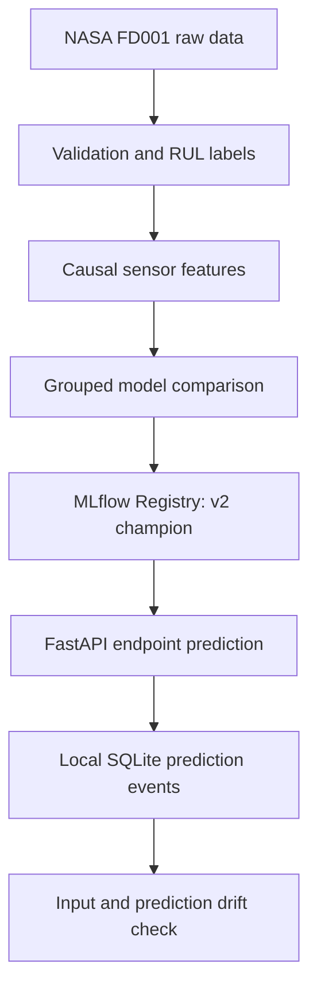

# ReliabilityML architecture

The selected model is a Random Forest using 48 features and
`min_samples_leaf=3`. Training and cross-validation keep all cycles
of an engine within the same group. Inference uses only observed cycles
from one engine to construct its endpoint features.

GitHub Actions runs pytest and builds the API Docker image in CI.
A separate manual CD workflow uses GitHub OIDC to deploy the existing
version 2 model image to private Cloud Run. Revision
`reliabilityml-api-00003-bl6` passed an authenticated prediction smoke
test with 180.89 predicted cycles for test engine 1.

After the trial, the Cloud Run service and Artifact Registry repository
were deleted and project billing was disabled. The cloud endpoint is
not currently active. SQLite monitoring and drift checks remain local
demonstrations without persistent cloud storage or live failure labels.