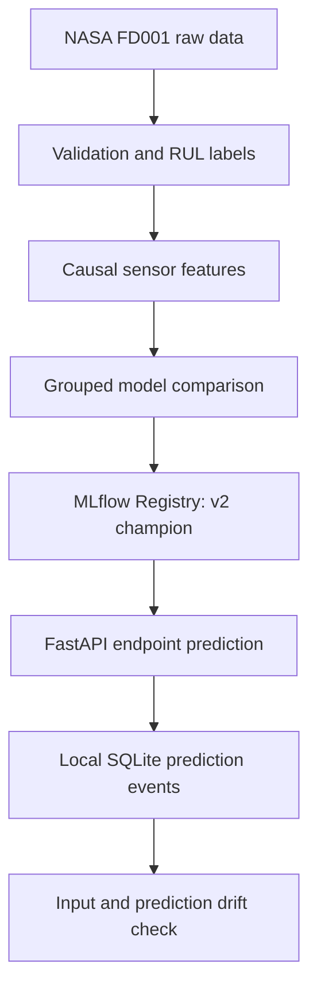

# ReliabilityML architecture

The selected model is a Random Forest using 48 features and
`min_samples_leaf=3`. Training and cross-validation keep all cycles
of an engine within the same group. Inference uses only observed cycles
from one engine to construct its endpoint features.

GitHub Actions runs pytest and then builds the API Docker image.
The deployment-ready image includes the version 2 model and passed
local `/health` and `/predict` smoke tests.

Cloud Run deployment has not been performed. The SQLite events and
drift check are local demonstrations; the planned cloud trial does not
provide persistent monitoring storage or live failure labels.